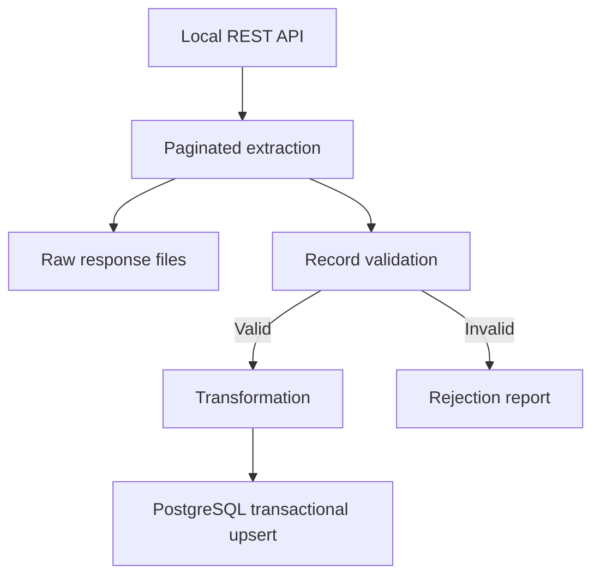

# Partner Catalog Ingestion

[](https://github.com/JakLit00/partner-catalog-ingestion/actions/workflows/quality-checks.yml)

[](LICENSE)

A Python ETL pipeline that ingests product catalog data from a REST API into PostgreSQL, with validation, raw data preservation and transactional upserts.

## Business context

A company receives product data from an external partner and needs an up-to-date catalog for internal applications and reporting. Product names, categories, prices and stock levels may change between imports, while invalid records and duplicate products must be handled reliably.

The pipeline addresses these requirements through validated imports, updates by product ID and transaction rollback on database failures.

For reproducibility, the project uses a fixed snapshot of **194 products from DummyJSON**, exposed through a local REST API rather than a live partner integration.

## Architecture



### Key features

- **Reliable extraction:** API pagination, timeouts and retries with exponential backoff.
- **Data quality:** field validation, rejection reports and database constraints.
- **Idempotent loading:** `INSERT ... ON CONFLICT DO UPDATE` prevents duplicate product IDs.
- **Transaction safety:** database failures roll back the entire load.
- **Traceability:** raw JSON responses, structured logs and unique run IDs.
- **Access control:** a restricted PostgreSQL importer role with only the required permissions.
- **Automated testing:** 73 default tests, 8 PostgreSQL integration tests, Ruff and cross-platform CI.

## Stack

- **Python 3.13 / 3.14** — Requests, urllib3, Psycopg 3 and `Decimal`.
- **PostgreSQL 16** — constraints, transactional upserts and a restricted importer role.
- **Docker Compose** — PostgreSQL and a read-only JSON Server API.
- **python-dotenv and python-json-logger** — configuration and JSON console logs.
- **pytest, Ruff and GitHub Actions** — automated tests, code checks and formatting.

### Data outputs

| Output | Description |
|---|---|
| `data/raw/<run_id>/` | Original API responses, preserved before JSON parsing |
| `data/rejected/<run_id>.json` | Invalid records with validation errors |
| `public.products` | Validated catalog containing ID, title, category, price and stock |
| JSON console logs | Run status, processing counts and error context |

## Run locally

<details>
<summary><strong>Expand setup, execution, verification and testing instructions (Windows/Linux)</strong></summary>

### 1. Prepare the environment

**Requirements:** Python 3.13 or 3.14, Docker with Docker Compose, and available host ports 3000 and 5433. Windows requires Docker Desktop with Linux containers. Node.js and PostgreSQL run inside containers.

Run commands from the repository root. Initial dependency installation and image builds require internet access; imports use the bundled dataset.

**Windows — PowerShell**

```powershell
py -3.13 -m venv .venv
.\.venv\Scripts\python.exe -m pip install -r requirements-dev.txt
Copy-Item .env.example .env
```

**Linux — Bash**

```bash
python3 --version
python3 -m venv .venv
.venv/bin/python -m pip install -r requirements-dev.txt
cp .env.example .env
```

Create `.env` only during initial setup. The commands use explicit interpreter paths, so virtual environment activation is unnecessary.

On Ubuntu, if `ensurepip` is missing, install the matching venv package (for example, `sudo apt install python3.14-venv`).

For WSL2, enable Docker Desktop's **Settings → Resources → WSL Integration**, verify `docker ps`, and create a separate Linux checkout with its own `.venv` and `.env`. See [platform verification](docs/development-notes.md#8-platform-verification).

### 2. Configure credentials

Edit `.env`:

```dotenv
POSTGRES_DB=partner_catalog
POSTGRES_ADMIN_USER=catalog_app
POSTGRES_ADMIN_PASSWORD=replace_with_your_local_admin_password
POSTGRES_USER=catalog_ingestor
POSTGRES_PASSWORD=replace_with_your_local_app_password
POSTGRES_HOST=127.0.0.1
POSTGRES_PORT=5433
API_BASE_URL=http://127.0.0.1:3000
API_TIMEOUT_SECONDS=10
```

Replace both password placeholders with different local passwords. `.env` is ignored by Git.

- `catalog_app` initializes and administers the database.
- `catalog_ingestor` is the restricted application role.
- Keep the supplied role names when following the commands below. The role creation script explicitly uses `catalog_ingestor`.

Changing `.env` does not update passwords in an existing PostgreSQL volume. Existing process environment variables take precedence over `.env` values.

### 3. Start services and initialize a new database

The following commands work in PowerShell and Bash:

```text
docker compose config --quiet
docker compose up -d --build
docker compose exec postgres pg_isready -U catalog_app -d partner_catalog
```

Wait for `accepting connections`. Repeat the readiness command if necessary.

The local API is available at `http://127.0.0.1:3000/products`.

**For a new database only**, execute the SQL scripts in order:

```text
docker compose cp sql/001_create_products.sql postgres:/tmp/001_create_products.sql
docker compose exec postgres psql -U catalog_app -d partner_catalog -v ON_ERROR_STOP=1 -1 -f /tmp/001_create_products.sql

docker compose cp sql/002_create_app_role.sql postgres:/tmp/002_create_app_role.sql
docker compose exec postgres psql -U catalog_app -d partner_catalog -v ON_ERROR_STOP=1 -1 -f /tmp/002_create_app_role.sql
```

Expected messages: `CREATE TABLE`, `CREATE ROLE` and three `GRANT` messages.

Each script runs transactionally and stops on errors. They are not rerunnable migrations: do not recreate an existing table or role. The importer does not initialize the database automatically.

**Set the importer password:**

```text
docker compose exec postgres psql -U catalog_app -d partner_catalog
```

Inside `psql`:

```text
\password catalog_ingestor
```

Enter the same password as `POSTGRES_PASSWORD` in `.env`, then confirm it. Exit with:

```text
\q
```

The password is not stored in SQL. Ordinary container restarts do not require repeating initialization.

### 4. Import and inspect the catalog

**Windows**

```powershell
.\.venv\Scripts\python.exe check_connection.py
.\.venv\Scripts\python.exe extract.py
```

**Linux**

```bash
.venv/bin/python check_connection.py
.venv/bin/python extract.py
```

The connection check should identify `catalog_ingestor`.

Expected successful import:

- `product_count: 194`
- `valid_count: 194`
- `rejected_count: 0`
- `loaded_count: 194`

**Verify the PostgreSQL data:**

```text
docker compose exec postgres psql -U catalog_ingestor -d partner_catalog -c "SELECT COUNT(*) AS product_count FROM public.products;"
docker compose cp sql/example_queries.sql postgres:/tmp/example_queries.sql
docker compose exec postgres psql -U catalog_ingestor -d partner_catalog -v ON_ERROR_STOP=1 -P pager=off -f /tmp/example_queries.sql
```

The example queries inspect the catalog summary, product samples, stock availability and category distribution.

Repeated imports retain **194 unique products**, updating existing IDs without duplicates. `loaded_count` includes updated rows, not only new inserts.

Optional pgAdmin connection: host `127.0.0.1`, port `5433`, database `partner_catalog`, user `catalog_ingestor` and its configured password.

### 5. Tests and code quality

**Windows**

```powershell
.\.venv\Scripts\python.exe -m ruff check .
.\.venv\Scripts\python.exe -m ruff format . --check
.\.venv\Scripts\python.exe -m pytest -q
```

**Linux**

```bash
.venv/bin/python -m ruff check .
.venv/bin/python -m ruff format . --check
.venv/bin/python -m pytest -q
```

Expected result: **73 passed, 8 skipped**.

The default suite covers validation, transformation, configuration, file output, pagination and error handling. It does not require Docker or PostgreSQL.

#### PostgreSQL integration tests

Integration tests run against an isolated, disposable PostgreSQL instance. Docker must be running, and host port **55432** must be available. The demo database, API and application `.env` are not required.

**Start the test database (Windows/Linux):**

```text
docker compose -f compose.test.yaml up -d --wait
```

**Run the complete suite — Windows:**

```powershell
.\.venv\Scripts\python.exe -m pytest -q --run-integration
```

**Linux:**

```bash
.venv/bin/python -m pytest -q --run-integration
```

Expected result: **81 passed**, including 8 database integration tests.

To execute only integration tests, add `tests/integration` after `pytest`.

**Stop the test database:**

```text
docker compose -f compose.test.yaml down
```

The test instance uses temporary storage and separate credentials. It verifies inserts, upserts, transaction rollbacks, constraints and restricted-role permissions. Run database tests sequentially against this instance.

For startup troubleshooting:

```text
docker compose -f compose.test.yaml logs --no-color
```

For a fresh initialization, run `down` followed by `up -d --wait`. Test credentials are disposable and must not be reused in shared or deployed databases.

#### Optional manual rollback verification

After a successful demo import:

**Windows**

```powershell
# Windows
.\.venv\Scripts\python.exe check_rollback.py
```

**Linux**

```bash
# Linux
.venv/bin/python check_rollback.py
```

The script tests whether a failed transaction leaves the original product unchanged. It uses product ID `1` and the application `.env`.

### 6. Stop and restart

```text
docker compose stop
docker compose up -d
```

The named PostgreSQL volume preserves data and roles. Removing that volume deletes the stored database.

</details>

## Testing and CI

[GitHub Actions](.github/workflows/quality-checks.yml) runs five automated jobs:

- Four quality-check combinations: Python 3.13/3.14 on Windows and Ubuntu.
- One PostgreSQL integration job on Ubuntu, validating actual SQL operations, transactions and database permissions.

The workflow runs on pushes to `main`, pull requests and manual dispatch. It requires no application secrets. Full API-to-database ingestion is verified locally rather than in CI.

Detailed test coverage, development decisions and verification results are documented in [Development Notes](docs/development-notes.md).

## Scope and limitations

This is a **local batch ETL portfolio project**, not a production deployment.

- Imports are manually triggered; scheduling and concurrent execution are outside the scope.
- Existing products are updated, but missing source records are not deleted and historical price changes are not tracked.
- The local API uses a fixed snapshot for reproducible tests rather than live partner data.

## Dataset and license

The dataset originates from [DummyJSON](https://dummyjson.com/docs/products). The original snapshot is preserved in `api/catalog-source.json`, while `api/db.json` provides the local API collection.

Project code: [MIT License](LICENSE). The bundled dataset retains its [upstream license notice](api/DUMMYJSON-LICENSE.txt).